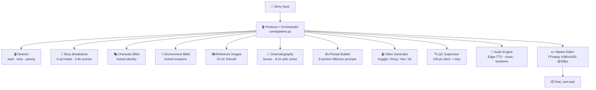

<div align="center">

# 🎬 AI Video Pipeline

### *CineStorm AI — Autonomous Multi-Agent Virtual Film Studio*

**Turn a one-line story idea into a cinematic vertical reel — directed, shot, voiced & edited by 11 AI agents.**

[](https://www.python.org/)
[](web/app.py)
[](studio-ui/)
[](https://ffmpeg.org/)
[](LICENSE)

[Features](#-features) • [Architecture](#️-architecture) • [Quick Start](#-quick-start) • [CLI](#️-cli-reference) • [Agents](#-the-11-agents) • [Web Studio](#-web-studio) • [Config](#-configuration)

</div>

---

## ✨ Features

| | What you get |
|---|---|
| 🎬 **11-agent film crew** | Director → Story → Character & Environment Bibles → References → Cinematography → Prompts → Video → QC → Audio → Editor |
| 🔒 **Consistency engine** | Locked Character Bible (7-layer) + Environment Bible (Kelvin lighting, palette, haze) + verbatim prompt reuse — no morphing faces |
| 💸 **100% free path** | Kaggle Tesla T4 (LTX-Video) for video · Edge-TTS for voiceover · Gemini Flash / HuggingFace for LLM — zero paid keys required |
| 🔌 **Smart LLM router** | Auto-detects `OmniRoute → OpenRouter → Gemini → NVIDIA NIM → DeepSeek → Qwen → OpenAI → HuggingFace` and picks best model per agent tier |
| 🎥 **Multi-provider video** | `kaggle → kling → krea → huggingface → veo → fal → replicate` fallback chain + per-scene model routing |
| 📱 **Platform presets** | Instagram Reel, YouTube Shorts, TikTok (`1080×1920`) + Cinematic (`1920×1080`) with EBU R128 loudness |
| 🌐 **Two frontends** | FastAPI + WebSocket telemetry backend (`web/`) **and** React + Tailwind studio floor (`studio-ui/`) |
| 🔬 **REA integration** | `agy rea` — reverse-engineer video tools into reusable intelligence profiles |
| 🧪 **Mock-tested** | `pytest` suite runs the full pipeline with zero API keys |

---

## 🏗️ Architecture



### The 5 Rules of Consistency

1. **Character Bible** — never describe the same character twice, differently.
2. **Environment Bible** — lock palette, materials, Kelvin temps (e.g. 6500K screen-blue vs 3200K tungsten).
3. **Simple Motion** — one motivated camera move per clip, low intensity.
4. **Prompt Formula** — `Style + Character + Location + Action + Camera + Lighting + Mood + Constraints`.
5. **QC Loop** — reject any clip that breaks character / environment lock (auto-retry ×3).

---

## 🚀 Quick Start

### 1. Prerequisites

- **Python 3.10+** · **ffmpeg** (`sudo apt install ffmpeg`) · **git**
- Optional: Node 18+ (only for `studio-ui/`)

### 2. Install

```bash
git clone https://github.com/HeyMeMukul/AI-Video-Pipeline.git
cd AI-Video-Pipeline

python3 -m venv .venv && source .venv/bin/activate
pip install -r requirements.txt

cp .env.example .env   # ← fill in only the keys you have; free path works without
```

> 💡 **Zero-cost setup:** set just `GOOGLE_API_KEY` (Gemini free tier) + `HF_TOKEN` (optional) + Kaggle creds for video. Voiceover falls back to free Edge-TTS automatically.

### 3. Make your first reel (interactive)

```bash
python3 scripts/agy.py create
# 💡 story idea → ⚙️ settings → 🧠 enhanced screenplay → 🚀 full pipeline runs
```

### 4. Or manual mode

```bash
# Initialize a project
python3 scripts/agy.py init --name "my_story" \
  --story "A lonely robot wakes up in an abandoned neon city." \
  --duration 30 --platform instagram_reel

# Run the full 11-agent pipeline
python3 scripts/agy.py run --project projects/my_story/project.json

# Watch your reel
ffplay projects/my_story/output/final_reel.mp4
```

---

## 🖥️ CLI Reference

| Command | What it does | Example |
|---|---|---|
| `init` | Scaffold a new project | `agy.py init --name x --story "..." --duration 30 --platform instagram_reel` |
| `create` | Interactive producer (enhance + auto-run) | `agy.py create` |
| `run` | Full pipeline | `agy.py run --project projects/x/project.json` |
| `stage` | Single agent only | `agy.py stage --project projects/x/project.json --stage director` |
| `status` | Project + scene + QC dashboard | `agy.py status --project projects/x/project.json` |
| `list` | All projects | `agy.py list` |
| `reset` | Re-run a stage | `agy.py reset --project projects/x/project.json --stage video` |
| `providers` | Show detected LLMs + per-agent routing | `agy.py providers` |
| `rea` | Reverse-engineer a tool / list profiles | `agy.py rea --list-profiles` |
| `serve` | Launch web studio backend | `agy.py serve --port 8000` |

**Stages:** `director · story · character · environment · references · cinematography · prompts · video · qc · audio · editor`

**Flags:** `--skip-references` · `--skip-audio` · `--skip-editor`

---

## 🤖 The 11 Agents

| # | Agent | File | Prompt | Output |
|---|---|---|---|---|
| 1 | 🎬 **Director** | `agents/director.py` | `prompts/director.md` | Style lock, tone, pacing, negative-avoid list |
| 2 | 📖 **Story Breakdown** | `agents/story_breakdown.py` | `prompts/story_breakdown.md` | 3-act scene beats with durations |
| 3 | 🎭 **Character Bible** | `agents/character_bible.py` | `prompts/character_bible.md` | 7-layer locked identity |
| 4 | 🌆 **Environment Bible** | `agents/environment_bible.py` | `prompts/environment_bible.md` | 5-pillar space + Kelvin lighting |
| 5 | 🖼️ **Reference Images** | `agents/reference_image.py` | `prompts/reference_image.md` | Model sheets, location plates, keyframes |
| 6 | 🎥 **Cinematography** | `agents/cinematography.py` | `prompts/cinematography.md` | 35/50mm primes, 9:16 safe zones, push-ins |
| 7 | ✍️ **Prompt Builder** | `agents/prompt_builder.py` | `prompts/prompt_builder.md` | Canonical 8-section Veo-ready prompts |
| 8 | 🎬 **Video Generator** | `agents/video_generator.py` | — | `.mp4` clips via Kaggle/Kling/Krea/Veo/fal |
| 9 | 🔍 **QC Supervisor** | `agents/qc.py` | `prompts/qc.md` | 100-pt score, auto-retry ≤3 |
| 10 | 🎵 **Audio Engine** | `agents/audio.py` | `prompts/audio.md` | Voiceover + music + SFX, −14 LUFS |
| 11 | ✂️ **Master Editor** | `agents/editor.py` | `prompts/editor.md` | FFmpeg `1080×1920@30fps` final reel |

> 📚 Each agent's Hollywood + diffusion knowledge lives in `skills/<agent>/SKILL.md` — the pipeline reads it before every stage. Start with `MASTER_STARTER_PROMPT.md` for the full producer briefing.

---

## 🌐 Web Studio

Two frontends, one pipeline:

```bash
# Backend (FastAPI + WebSocket telemetry)
python3 scripts/agy.py serve --host 0.0.0.0 --port 8000
# → http://localhost:8000   ·   ws://localhost:8000/ws

# Studio floor UI (React + Tailwind + Zustand + Framer Motion)
cd studio-ui && npm install && npm run dev
```

---

## ⚙️ Configuration

| File | Purpose |
|---|---|
| `config.yaml` | Models, providers, fallback chains, QC thresholds, platform presets, output codec |
| `.env` *(you create, never committed)* | API keys — see `.env.example` for the full list |

**LLM auto-routing** (`config.yaml → llm.routing`):

| Tier | Agents | Default pick |
|---|---|---|
| `heavy` | director, character | best reasoning model available |
| `medium` | story, environment, cinematography, audio | balanced |
| `fast` | prompt_builder, qc, editor, video | cheap + fast |
| `ultra_fast` | JSON transforms | smallest free model |

Check live routing anytime: `python3 scripts/agy.py providers`

**Video fallback chain:** `kaggle → kling → krea → huggingface → veo → fal → replicate`
**Free TTS:** Edge-TTS (no key) · **Free image alt:** `black-forest-labs/FLUX.1-schnell`

---

## 📁 Project Structure

```
AI-Video-Pipeline/
├── scripts/agy.py            ← CLI entry point (init/create/run/stage/status/serve)
├── core/                     ← pipeline.py · project.py · llm.py · video_client.py
│                                image_client.py · kaggle_client.py · rea_bridge.py
├── agents/                   ← 11 agent implementations
├── prompts/                  ← system prompt per agent
├── skills/                   ← Hollywood + AI knowledge base per agent
├── web/                      ← FastAPI backend + WebSocket telemetry
├── studio-ui/                ← React studio-floor frontend
├── config.yaml               ← all knobs & fallback chains
├── projects/<name>/          ← project.json · story.txt · scene_prompts/
│                               references/ · clips/ · audio/ · output/final_reel.mp4
└── tests/test_pipeline.py    ← mock-client integration tests
```

**MVP scope:** 1–3 paragraph story → 15–30s reel · 9:16 · 2–4 clips × 6–8s · 1 character · 1–2 locations · music + voiceover (dialogue coming soon).

---

## 🧪 Tests

```bash
python -m pytest tests/test_pipeline.py -v   # no API keys needed (mock clients)
```

---

## 🗺️ Roadmap

- [ ] Multi-character consistency graphs
- [ ] Dialogue / lip-sync stage
- [ ] Real-ESRGAN upscale pass (`output.upscale: true`)
- [ ] One-click deploy for `web/` + `studio-ui/`
- [ ] More REA profiles for trending video tools

---

## 🤝 Contributing

PRs welcome! Keep agents small, prompts in `prompts/`, deep knowledge in `skills/<agent>/SKILL.md`, and add a mock test in `tests/`.

## 📄 License

MIT — see [LICENSE](LICENSE) *(adding soon if missing)*.

---

<div align="center">

**Built like a real film studio — because consistency is a pipeline, not a prompt. 🎬**

⭐ Star this repo if it helped you ship a reel!

</div>
